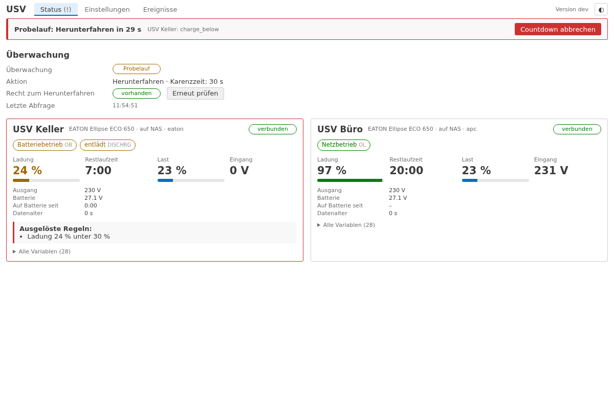
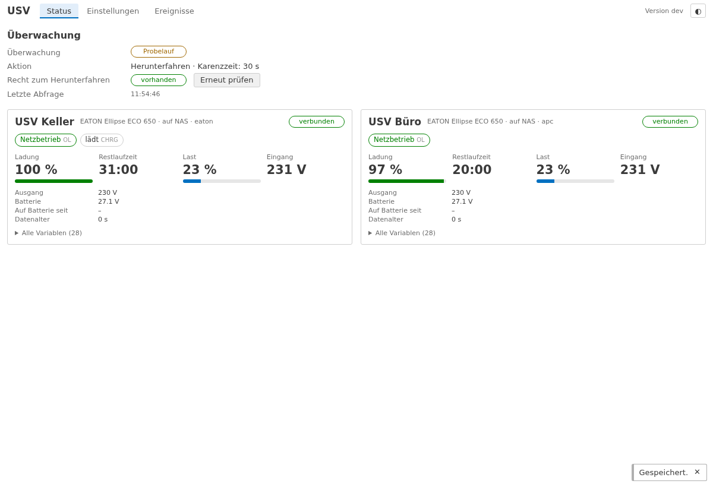
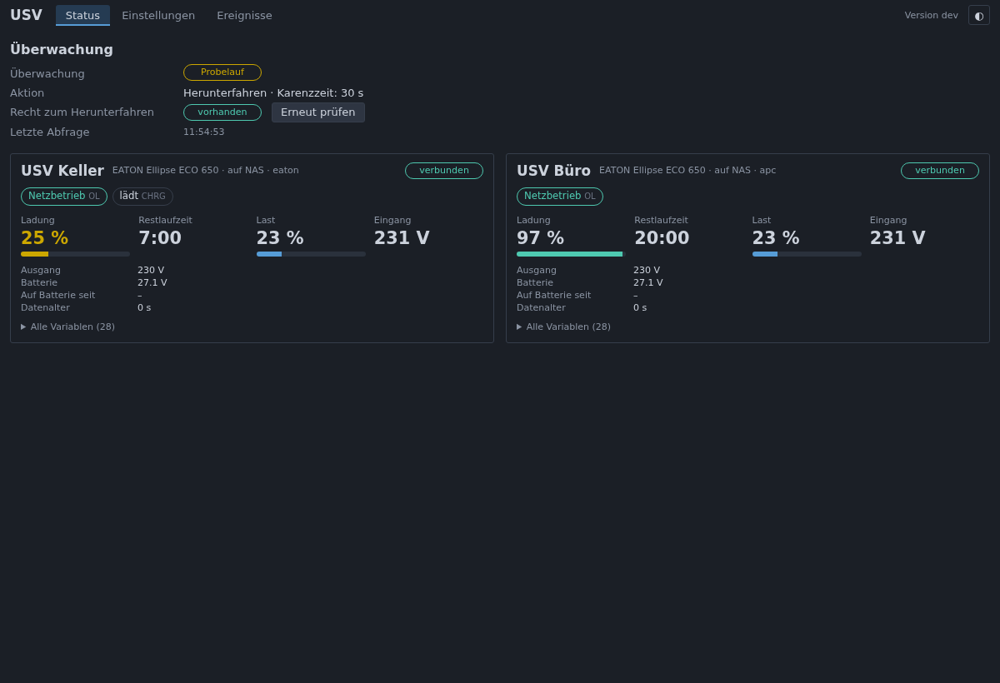
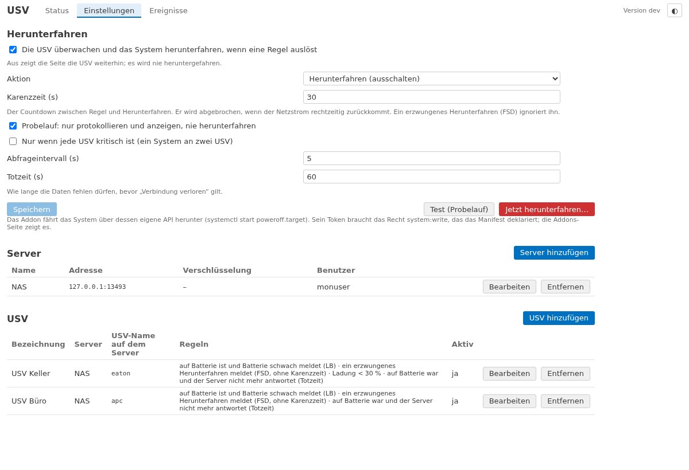
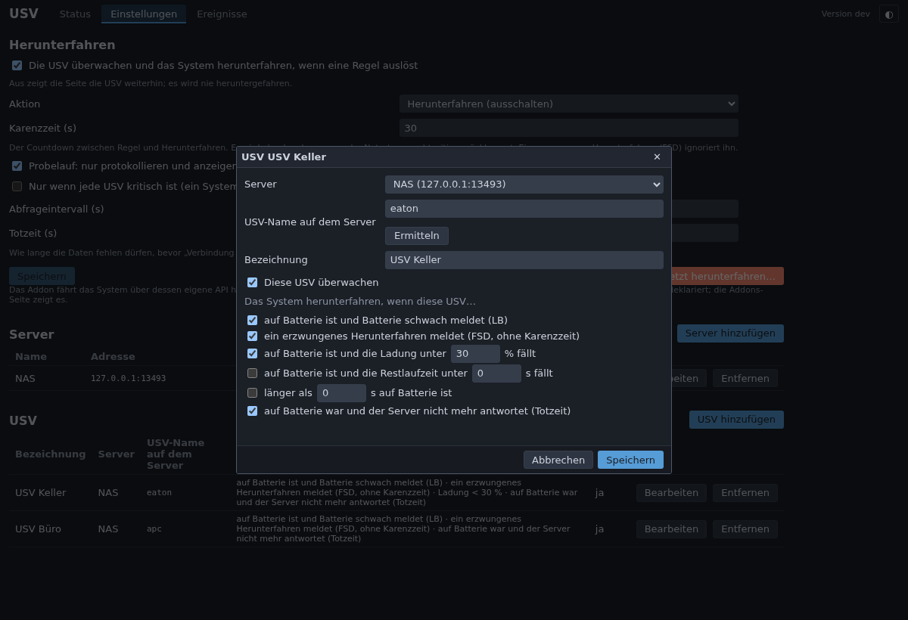
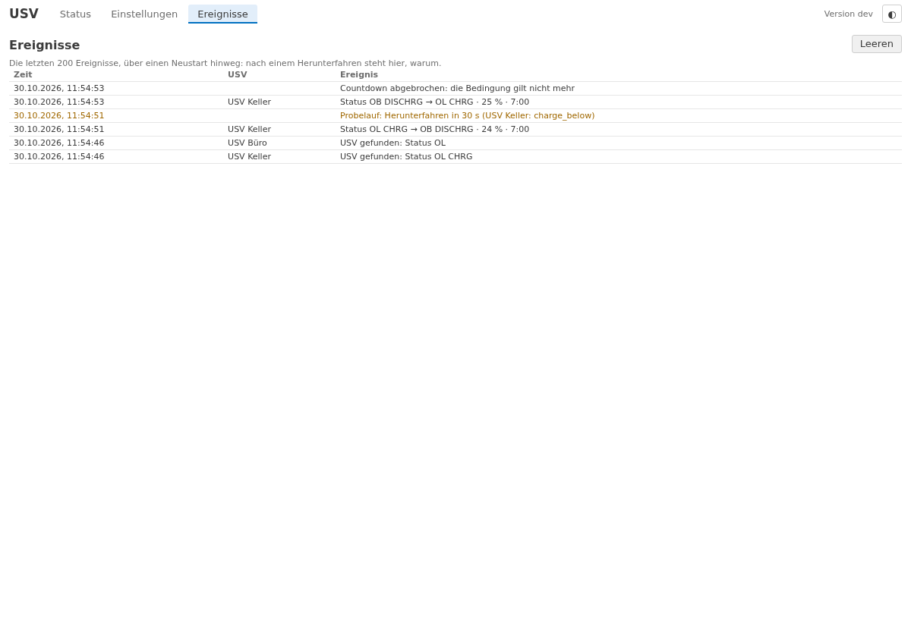
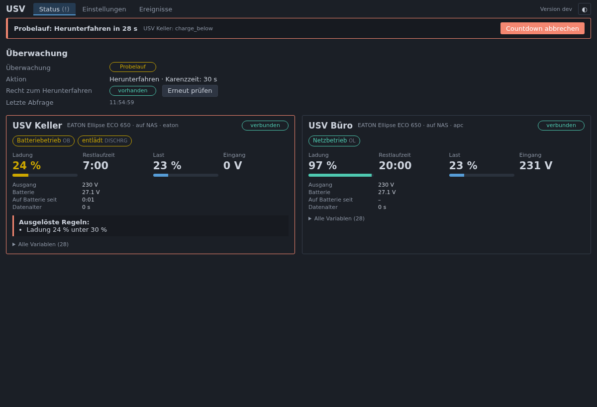

# lite-addon-nut

*[English](README.en.md)*

Ein **Client für Network UPS Tools (NUT)** für [openccu-lite](https://github.com/hobbyquaker/openccu-lite): Er
verbindet sich mit dem `upsd`, an dem Ihre USV hängt – ein NAS, ein Proxmox-Host, ein Raspberry Pi am USB-Kabel der
USV –, zeigt den Zustand der USV und **fährt das System sauber herunter**, bevor der USV die Energie ausgeht. Das
schützt die SD-Karte, das Dateisystem und die Gerätedateien der Funkschnittstellen.



## Was es tut

- **Verbindet sich mit einem oder mehreren upsd-Servern** (TCP 3493), unverschlüsselt oder mit **STARTTLS** (Zertifikat
  gegen die Systemwurzeln oder eine eigene CA geprüft, oder so akzeptiert, wie es ist), mit oder ohne Anmeldung
  (`upsd.users`). Je Server eine Verbindung, die bei einem Fehler neu aufgebaut wird; im Abfrageintervall (Standard
  5 s) ein `LIST VAR` je USV. **Nur ausgehende Verbindungen; kein offener Port.**
- **Zeigt je USV** den Status (Netzbetrieb, Batteriebetrieb, Batterie schwach, lädt, entlädt, Bypass, Überlast, …),
  Ladung, Restlaufzeit, Last, Eingangs- und Ausgangsspannung, Batteriespannung, Temperatur, wie lange sie auf
  Batterie ist, und auf Wunsch jede Variable, die der Server liefert.
- **Regeln je USV**, die das System herunterfahren:

  | Regel | Wann |
  | --- | --- |
  | Batterie schwach (LB) | die USV ist auf Batterie und meldet `LB` – Standard an |
  | Erzwungenes Herunterfahren (FSD) | der NUT-Master hat `FSD` gesetzt – Standard an, **ohne Karenzzeit** |
  | Ladung unter X % | auf Batterie und `battery.charge` unter der Schwelle |
  | Restlaufzeit unter Y s | auf Batterie und `battery.runtime` unter der Schwelle |
  | Länger als Z s auf Batterie | unabhängig von Ladung und Restlaufzeit |
  | Verbindung verloren | der Server antwortet nicht mehr (oder die USV ist `DATA-STALE`), und die USV war zuletzt auf Batterie – nach der Totzeit (Standard 60 s); die Regel von `upsmon` – Standard an |

- **Karenzzeit** (Standard 30 s): Zwischen Regel und Herunterfahren läuft ein Countdown, den die Seite anzeigt. Kommt
  der Netzstrom rechtzeitig zurück, wird er **abgebrochen**. Ein Knopf bricht ihn auch von Hand ab; die auslösende USV
  wird dann ignoriert, bis sie wieder am Netz ist.
- **Aktion:** Herunterfahren (Standard; die USV schaltet die Last später ab, und nach Netzrückkehr startet das System
  mit der Stromversorgung) oder Neustart.
- **Probelauf:** protokolliert und zeigt, was passieren würde, fährt aber nie herunter. Ein **Test**-Knopf für den
  Probelauf und einer, der den ganzen Weg in echt prüft.
- **Mehrere USV:** jede kann auslösen, oder – für ein System an zwei USV – erst, wenn jede kritisch ist.
- **Ereignisprotokoll:** Statuswechsel, Countdowns, Abbrüche, Herunterfahren und Probeläufe, die letzten 200, über
  einen Neustart hinweg – nach einem Herunterfahren steht hier, warum.

## Installation

1. Das Paket `nut-<arch>-<version>.tar.gz` von der [Releases-Seite](https://github.com/hobbyquaker/lite-addon-nut/releases)
   über die Addons-Seite des Systems installieren. Das Addon steht vorerst nicht im Katalog.
2. Auf der Addon-Seite (*USV* im Addon-Menü oder *Einstellungen* auf der Addons-Seite) unter **Einstellungen → Server**
   den upsd eintragen (Host, Port, bei Bedarf Benutzer und Passwort, STARTTLS) und mit **Verbindung testen** prüfen:
   die Antwort nennt die Version des Servers und seine USV.
3. Unter **USV** eine USV anlegen: **Ermitteln** holt die Namen vom Server (`LIST UPS`); dann die Regeln setzen.
4. Unter **Herunterfahren** Aktion, Karenzzeit und Probelauf wählen. Zum Prüfen zuerst den Probelauf einschalten, den
   Netzstecker der USV ziehen und zusehen: die Statuskarte zeigt `OB`, der Countdown läuft, und unter *Ereignisse*
   steht, was das Addon getan hätte. Dann den Probelauf ausschalten.

Der upsd muss auf einer Adresse lauschen, die dieses System erreicht (`LISTEN 0.0.0.0 3493` in `upsd.conf`, oder die
Adresse des Servers), und seine Firewall den Port freigeben. Auf einem Synology-NAS ist das *Netzwerk-USV-Server
aktivieren* mit der IP dieses Systems in der Liste der erlaubten Geräte (dort heißt die USV `ups`, der Benutzer
`monuser` mit dem Passwort `secret`). Zum Lesen braucht upsd in der Regel keine Anmeldung; ein falsches Passwort fällt
beim Lesen nicht auf, denn upsd prüft es erst bei einer Aktion.

## Wie es herunterfährt

Das Addon fährt das System über dessen eigene API herunter, nicht mit `shutdown` oder `systemctl` aus dem eigenen
Prozess: `POST /api/system/v1/services/poweroff.target/start` (bzw. `reboot.target`), was das System als
`systemctl start poweroff.target` ausführt. Dafür deklariert das Manifest das Recht **`system:write`** – das einzige, das
das Addon hat. Das Recht `power`, das die eigentlichen Routen `POST /halt` und `POST /reboot` verlangen, erhält ein
Addon-Token grundsätzlich nicht; die Dienststeuerung von `system:write` ist der engste Weg, der heute funktioniert.
Die Statusseite zeigt unter *Recht zum Herunterfahren*, ob das Token es hat; die Addons-Seite des Systems zeigt das
Recht ebenfalls.

Das Addon läuft als eigener Benutzer ohne Zusatzrechte, öffnet keinen Port und verbindet sich nur mit den Servern, die
Sie eintragen. Die Konfiguration mit den Passwörtern liegt in `/usr/local/etc/config/addons/nut/nut.json` (Modus
0600), das Ereignisprotokoll in `/usr/local/addons/nut/var/events.json`. Ein Deinstallieren lässt die Konfiguration
für eine Neuinstallation liegen.

## Screenshots

| | |
| --- | --- |
|  |  |
|  |  |
|  |  |

## Entwicklung

```sh
go test -race ./...                         # die Go-Tests, mit einem upsd-Double
(cd ui && npm ci && npm run check && npm test && npm run build)
(cd ui && npx playwright test)              # die Seite gegen das System-Double (scripts/dev-serve.sh)
NUT_DOCKER=1 go test -count=1 -v ./test/upsd/   # gegen einen echten upsd (Debian nut-server, dummy-ups) in Docker
VERSION=0.1.0 scripts/build.sh              # die Pakete für aarch64, x86_64 und armv7l
```

`scripts/dev-serve.sh` startet den Daemon gegen ein kleines Demo-System mit zwei USV: Seite unter
`http://127.0.0.1:18297/addons/nut/`; `curl 'http://127.0.0.1:18080/dev/ups?name=eaton&status=OB+LB&charge=10'`
schaltet die USV um. Die API der Seite steht in [docs/api.md](docs/api.md).

## Lizenz

MIT. Siehe [LICENSE](LICENSE).
